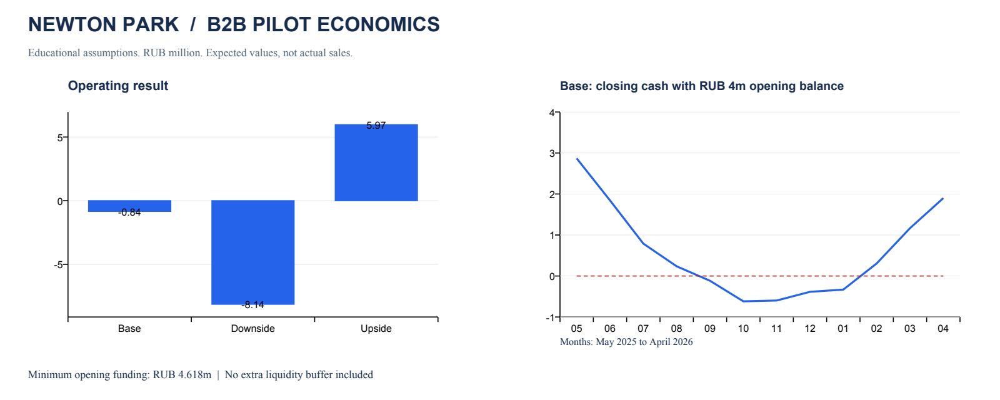

# Ньютон Парк: экономика B2B-пилота · School 21

**Илья Бочаров · бизнес-аналитика · Python · Excel · сценарный анализ**

Можно ли запускать B2B-пилот при среднем чеке 1,2 млн ₽, длинном цикле сделки и ограниченном бюджете? Этот учебный кейс проверяет экономику пилотного предложения и показывает, почему положительная маржа на контракте ещё не гарантирует прибыль и достаточный остаток денег.

**Вывод базового сценария:** полномасштабный запуск при заданных допущениях преждевременен. Ожидаемые 11 контрактов дают операционный убыток 0,84 млн ₽. Для покрытия максимального накопленного кассового дефицита нужно 4,618 млн ₽ без дополнительного резерва; стартовых 4 млн ₽ недостаточно.



## Задача и границы

**Задача:** оценить экономику пилота на 12 месяцев, определить условия безубыточности и потребность в финансировании. [Полная постановка и критерии готовности](TASK.md).

«Ньютон Парк» рассматривает выход к корпоративным заказчикам Китая. Для расчёта выбран один продукт: **платный пакет концепции интерактивного пространства** — исследование задачи заказчика, локализованная концепция, демонстрационные материалы и предварительная смета реализации. Покупатель — корпоративный заказчик. Строительство пространства и дальнейшее сопровождение в выручку не включены.

Финансовая модель построена на сценарных допущениях из кейса School 21. Исходные показатели и добавленные параметры разделены в [описании источников](docs/assumptions.md).

## Результаты

| Показатель | Базовый | Негативный | Позитивный |
|---|---:|---:|---:|
| Ожидаемые контракты в пределах 12 месяцев | 11,00 | 4,67 | 15,81 |
| Выручка, млн ₽ | 13,200 | 4,766 | 20,873 |
| Операционный результат, млн ₽ | −0,840 | −8,135 | 5,966 |
| Минимальное стартовое финансирование, млн ₽ | 4,618 | 8,622 | 3,508 |

Дробное количество контрактов — математическое ожидание, а не число состоявшихся продаж. Сценарии не имеют присвоенных вероятностей. Выручка признаётся при выполнении пакета, деньги поступают по графику оплаты.

В базовом случае вклад одного контракта после прямых затрат — **1,02 млн ₽**. При фиксированных затратах **12,06 млн ₽** для операционной безубыточности нужно **12 целых контрактов**, выполненных в расчётном периоде. Это не гарантирует безубыточность денежного потока.

## Что сделано

- Восстановлены помесячные исходные данные и устранено расхождение между помесячным расчётом и годовой средней конверсией.
- Построена модель по когортам лидов с задержкой сделки и поступления денег.
- Разделены прямые затраты, фиксированные расходы, операционный результат и денежный поток.
- Добавлены три сценария и анализ чувствительности к срокам продаж и стоимости выполнения контракта.
- Подготовлена редактируемая [Excel-модель](reports/newton_park_model.xlsx) базового сценария и автоматические проверки расчётов.

## Решение по запуску

Начать с проверки цены и состава пакета на потенциальных заказчиках, затем получить оценку прямых затрат от исполнителей. До увеличения расходов нужно подтвердить условия оплаты и длительность сделки. При сохранении базового спроса экономику можно вывести к операционной безубыточности сокращением годовых фиксированных затрат минимум на 0,84 млн ₽; влияние изменений на качество и спрос требует отдельной проверки.

Подробнее: [расчёт и ограничения](docs/methodology.md), [источники и допущения](docs/assumptions.md), [разбор исходных расхождений](docs/reconciliation.md).

## Воспроизведение

Структура репозитория:

```text
TASK.md    — постановка задачи и критерии готовности
data/      — исходные вводные и сценарные допущения
src/       — расчётная модель и построение графика
tests/     — проверки расчётов и граничных случаев
reports/   — результаты, график и Excel-модель
docs/      — методика, источники и сверка исходных данных
```

Python 3.10+; расчёты и тесты используют только стандартную библиотеку.

```bash
python3 src/model.py
python3 -m unittest discover -s tests -v
```

Измените `data/monthly_inputs.csv`, `data/assumptions.json` или `data/scenarios.json`, затем повторите расчёт. Он обновит CSV и JSON в `reports/`. Excel — отдельная интерактивная версия базовой модели; Python не перезаписывает ручные изменения в книге.

Для обновления графика:

```bash
python3 -m pip install -r requirements-viz.txt
python3 src/plot.py
```

Таблица в этом README и графики — снимок исходных сценариев. При изменении допущений их нужно обновить. Формулы Excel пересчитываются внутри книги. [Проверки](tests/test_model.py) охватывают исходные контрольные суммы, нулевой спрос, длительные задержки, некорректные входы и согласование прибыли с денежным потоком.
